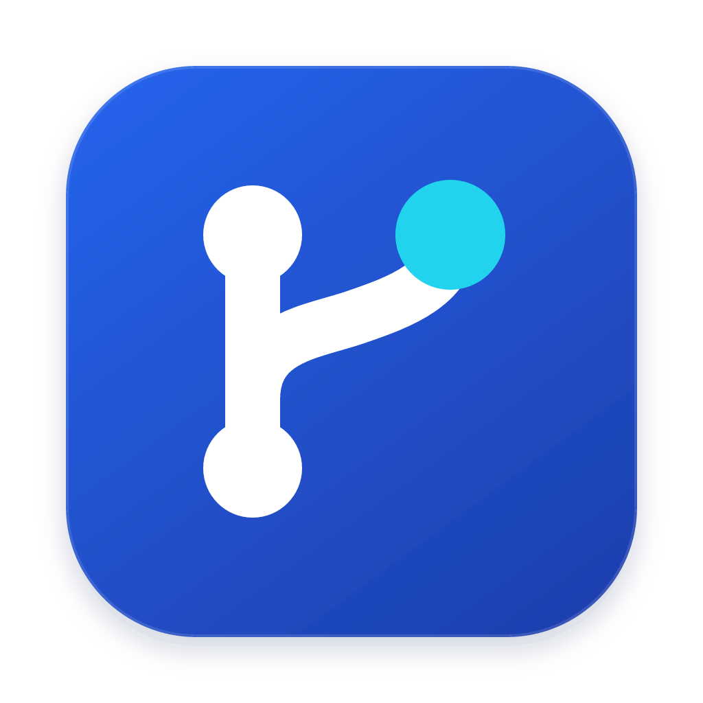

  

<h1 align="center">Alune</h1>

<a href="README.md">简体中文</a> · English

  <strong>One desktop app for your local and SSH-remote Git repositories.</strong>

  Review diffs, stage and commit, browse history, review PRs/MRs across repositories or open one from a repository, then keep working in a repository terminal. 
  Runs on macOS, Windows and Linux. Install and go: no Node.js and no separate backend to start.

  <a href="https://shaoclean.github.io/Alune/">Website</a> ·
  <a href="https://github.com/ShaoClean/Alune/releases/latest">Download</a> ·
  <a href="https://github.com/ShaoClean/Alune/issues/97">Changelog</a> ·
  <a href="#quick-start">Quick start</a> ·
  <a href="#features">Features</a> ·
  <a href="https://github.com/ShaoClean/Alune/wiki">Project docs</a> ·
  <a href="https://github.com/users/ShaoClean/projects/1">Public TODO</a>

From file diff to staging and commit, all in one Git workspace.

> [!NOTE]
> The Alune interface is currently available in Simplified Chinese only. This README gives each UI label in Chinese followed by an English gloss, e.g. “改动” (Changes), so you can find it in the app. The detailed guides under `docs/` are written in Chinese.

[Alune-UI docs](https://shaoclean.github.io/Alune/ui/) · [Shared component source](packages/ui/README.md)

## Features

| Feature                               | What you can do                                                                                                                                                                                                                                                                                                                                                                                                                                           |
| ------------------------------------- | --------------------------------------------------------------------------------------------------------------------------------------------------------------------------------------------------------------------------------------------------------------------------------------------------------------------------------------------------------------------------------------------------------------------------------------------------------- |
| **Local and SSH workspaces**          | Open Git repositories on this machine, or connect to servers with a password, private key or SSH agent and scan for repositories to register. Local and SSH repositories share the same diff, commit, history and sync UI.                                                                                                                                                                                                                                |
| **Text and image diffs**              | Unified, split and full-screen text diffs with previous/next change navigation; stage, unstage or discard by hunk or by line; configurable code theme, font and size. Before/after comparison for PNG, JPEG, GIF and WebP. Untracked files can be previewed without staging them first.                                                                                                                                                                   |
| **File browser**                      | Lazily loaded tree with Git status colors and markers; ignored files and folders are greyed out. Read-only previews of code (line numbers, highlighting), images and Markdown; line-by-line blame with jumps to history and parent revisions. `Cmd/Ctrl+F` searches diffs and file previews, with case, whole-word and regex matching. The context menu offers copy, stage, unstage, discard or delete where applicable.                                  |
| **Staging and commits**               | Separate unstaged and staged groups; write a summary and optional description, then commit what is staged. Bulk discard previews its scope first, keeps staged content, and asks separately before deleting untracked files.                                                                                                                                                                                                                              |
| **Branches and sync**                 | Create, switch, rename, safely delete and merge branches. The toolbar branch picker filters as you type, with arrow keys to move and Enter to switch. Switching to a remote branch creates or reuses a local tracking branch; if a same-named local branch already exists, Alune switches to it and tells you what it tracks. Pull, push, fetch and first-push upstream setup run in the background with progress in the status bar and can be cancelled. |
| **Conflicts and interactive rebase**  | Resolve conflicts from merge, rebase, cherry-pick and revert by taking a side or editing the final text, then stage it. Reorder, squash, reword or drop commits from a visual plan; continue, skip or abort after conflicts.                                                                                                                                                                                                                              |
| **Commit signing**                    | Configure GPG or SSH commit signing and see verification status in history. Keys and signing tools live on whichever host runs Git (this machine or the SSH host).                                                                                                                                                                                                                                                                                        |
| **Submodules and Git LFS**            | Inspect submodule status and pointer diffs; initialize, update and open submodules. Detect LFS pointers, preview cached images, and keep the LFS flow and transfer progress on push/pull.                                                                                                                                                                                                                                                                 |
| **Tags**                              | List and search local tags on the branches page, create lightweight or annotated tags from HEAD or any commit, push one or all tags, delete local and remote tags with confirmation, and create or check out branches from tags.                                                                                                                                                                                                                          |
| **History and stashes**               | A commit graph of fetched local branches, remote-tracking branches and tags, with infinite scroll and per-commit diffs. Filter by message, hash, author, date, branch and path; follow file history across renames. View, create, apply, pop and drop stashes.                                                                                                                                                                                            |
| **PR / MR collaboration**             | The PR/MR center gathers requests from every added repository. Read details, diffs and discussions in the app, and comment, review, merge or close as your permissions allow. Open same-repository PRs/MRs from a repository, optionally with AI-drafted title and description. Named access tokens and self-hosted GitLab over HTTPS are supported.                                                                                                      |
| **Tabs and worktrees**                | Drag tabs to reorder, scroll the tab bar with the wheel, close in bulk from the context menu; open repositories and their order are restored on restart. Create, open and delete worktrees locally; discover and open existing worktrees over SSH.                                                                                                                                                                                                        |
| **Repository terminal**               | Open the panel from the toolbar “终端” (Terminal) button or `` Ctrl+` ``, then click “新建” (New) to start a shell. Up to 8 sessions per window; sessions survive switching views or closing a repository tab. Closing a session or quitting the app asks for confirmation.                                                                                                                                                                               |
| **Repository overview**               | Switch the repositories page between cards, list and overview to see status and activity for the current filter. “采集统计” (Collect stats) reads commit and language statistics; the page shows cache time and coverage.                                                                                                                                                                                                                                 |
| **AI commit messages (optional)**     | Configure OpenAI, Anthropic, Gemini, DeepSeek or a compatible service to draft an editable summary and description from the staged diff. You review it before committing.                                                                                                                                                                                                                                                                                 |
| **Appearance, layout, notifications** | Moonlight light/dark themes, follow-system mode and reduced motion; four Catppuccin code themes plus VS Code theme JSON/JSONC import. Panels can be hidden and resized. Notifications live behind the bell in the status bar and can be cleared one by one or marked all read.                                                                                                                                                                            |
| **Local logs**                        | Records Git operations, SSH connections, hosting-platform and AI requests, and errors, with tokens and passwords redacted. Set directory, level and retention under “设置 → 日志” (Settings → Logs). “帮助 → 查看日志” (Help → View logs) or `Cmd/Ctrl+Shift+L` opens a live log window filterable by level, source and keyword.                                                                                                                          |
| **Network proxy and updates**         | HTTP, HTTPS or SOCKS5 proxy for AI, app updates, SSH and remote Git sync; remote forwarding does not require Python. The desktop app can check for, download and install updates.                                                                                                                                                                                                                                                                         |

The workspace is laid out as **tab bar → repository toolbar → content area → status bar**. In the Changes view the diff sits in the middle with files and the commit panel on the right; the terminal docks at the bottom of the content area. The toolbar lists “改动｜文件｜提交历史｜分支｜储藏｜远程｜PR/MR” (Changes | Files | History | Branches | Stashes | Remotes | PR/MR), plus terminal, refresh and sync buttons. The left navigation has “连接” (Connections), “仓库” (Repositories) and “PR/MR 中心” (PR/MR center); the “工作区导航” (Workspace navigator) in the status bar switches repositories, manages connections and opens settings.

<strong>Dark workspace, file reading and commit history</strong>

<strong>Repository terminal, PR/MR review and repository overview</strong>

<strong>Code theme and network proxy settings</strong>

Screenshots match **v0.10.0** and were taken from that version's real web UI with temporary Git repositories, a local test SSH server and demo data; PR/MR hosting responses are test fixtures. The terminal screenshot comes from an authenticated isolated server, with the command actually run in the demo repository. Desktop window chrome and system dialogs depend on your platform. [Screenshot baseline and capture notes](https://github.com/ShaoClean/Alune/wiki/README-Screenshots-v0.10.0) (Chinese)

## Download

Go to the **[latest stable release](https://github.com/ShaoClean/Alune/releases/latest)** and pick the installer for your OS and chip under Assets.

| System                | File                                    | How to install                                         |
| --------------------- | --------------------------------------- | ------------------------------------------------------ |
| macOS · Apple silicon | `Alune-<version>-mac-arm64.dmg`         | Open the DMG, drag Alune into Applications, launch it. |
| macOS · Intel         | `Alune-<version>-mac-x64.dmg`           | Open the DMG, drag Alune into Applications, launch it. |
| Windows · x64         | `Alune-<version>-win-x64.exe`           | Run the installer and choose an install location.      |
| Linux · x64           | `Alune-<version>-linux-x86_64.AppImage` | Mark the file as executable, then run the AppImage.    |

Each release ships `SHA256SUMS` for verification. Installers are not code-signed yet and the macOS build is not notarized, so your OS may warn on first launch; see the [desktop guide](docs/desktop.md) (Chinese) for install and update requirements. Existing users can check for and download updates under **“设置 → 版本更新” (Settings → Updates)**, then click “重启安装” (Restart to install).

## Quick start

Git must be installed on this machine and on any remote host that runs Git. Repository directories must be readable and writable; author identity and sync credentials come from the host that runs Git.

1. **Open a repository.** On the “仓库” (Repositories) page choose “打开本地仓库” (Open local repository). For SSH, add and test a connection on the “连接” (Connections) page, register remote repositories via “查看仓库 → 扫描并添加” (View repositories → Scan and add), then click “打开工作区” (Open workspace).
2. **Review and commit.** In “改动” (Changes), select a file to see its diff, stage what you want to commit, write a summary and description, and click “提交已暂存内容” (Commit staged). Pull or push as needed; to fetch only, use “更多推送选项” (More push options) next to Push.
3. **Open a terminal.** Click “终端” (Terminal) in the toolbar, check the start directory, then “新建” (New). After changing files, use “刷新仓库” (Refresh repository) to update the Git views. Each repository keeps its own sessions; collapsing the panel does not end them.
4. **Set up collaboration and networking.** For private repositories, save a named token under “设置 → 访问令牌” (Settings → Access tokens), then select it on the “PR/MR” page and click “应用到此仓库” (Apply to this repository). Save a proxy under “设置 → 网络代理” (Settings → Network proxy); existing SSH connections need “重新连接并应用” (Reconnect and apply).
5. **Optionally enable AI and code themes.** Configure a service and model under “AI 服务商” (AI providers), save a default model under “提交生成” (Commit generation), then use the sparkle button next to the commit summary. “外观 → 代码阅读” (Appearance → Code reading) sets theme, font and size for files and text diffs.

Shortcuts: `Cmd/Ctrl+B` toggles the left panel, `Cmd/Ctrl+Shift+B` the right panel, `Cmd/Ctrl+,` opens settings, `` Ctrl+` `` shows or hides the terminal, `Cmd/Ctrl+Shift+L` opens the log window, `Cmd/Ctrl+F` searches the diff or file, `F7` / `Shift+F7` jump to the next / previous change, and `Alt+←/→` moves the focused tab.

AI features send the staged diff to the service you configure; every Git feature works without AI. Closing a repository tab keeps its registration, directory and running terminals; ending a terminal does not roll back file changes, and terminal processes are not restored after restarting the app. Full details are in the [workspace guide](docs/workspace.md) (Chinese).

## Docs and development

The guides below are written in Chinese.

| Topic                                                         | Link                                                                                  |
| ------------------------------------------------------------- | ------------------------------------------------------------------------------------- |
| Layout, diffs, history, PR/MR, worktrees and terminal         | [Workspace guide](docs/workspace.md)                                                  |
| PR/MR center, creating requests and AI drafting               | [PR/MR guide](docs/pull-requests.md)                                                  |
| Commit signing and verification status                        | [Commit signing](docs/commit-signing.md)                                              |
| Submodule setup and Git LFS preview/transfer                  | [Submodules and Git LFS](docs/submodules-lfs.md)                                      |
| Installation, updates, data directory, logs, desktop behavior | [Desktop guide](docs/desktop.md)                                                      |
| AI providers, models and keys                                 | [AI settings](docs/ai-settings.md)                                                    |
| Proxy settings, when they apply, remote Git forwarding        | [Network proxy](docs/network-proxy.md)                                                |
| Running from source, building and testing                     | [Development and packaging](docs/development.md)                                      |
| Unreleased changes and version history                        | [Public changelog](https://github.com/ShaoClean/Alune/issues/97)                      |
| Commit conventions, Git hooks and releases                    | [Contributing and releasing](CONTRIBUTE.md)                                           |
| Feature designs, acceptance records and screenshots           | [GitHub Wiki](https://github.com/ShaoClean/Alune/wiki) · [Docs index](docs/README.md) |

## Feedback and contributing

Report bugs or suggest ideas with the [issue templates](https://github.com/ShaoClean/Alune/issues/new/choose), or pick a task from the [public TODO board](https://github.com/users/ShaoClean/projects/1). Planned features are tracked as issues.

Before opening a PR, read the [contributing guide](.github/CONTRIBUTING.md), link the related issue and record how you verified the change. Designs, acceptance records and screenshots live in the Wiki; see the [maintenance conventions](https://github.com/ShaoClean/Alune/wiki/Contributing) and [migration checklist](https://github.com/ShaoClean/Alune/wiki/Migration-25).
